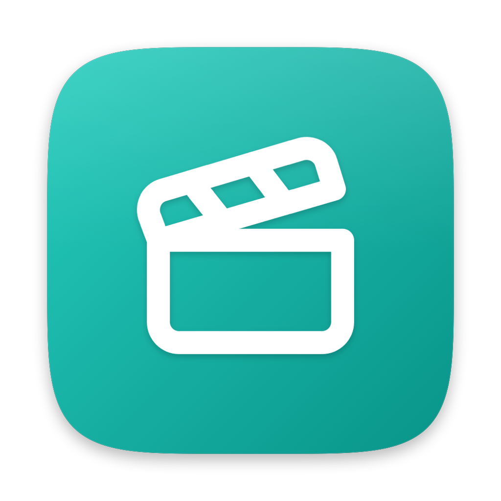
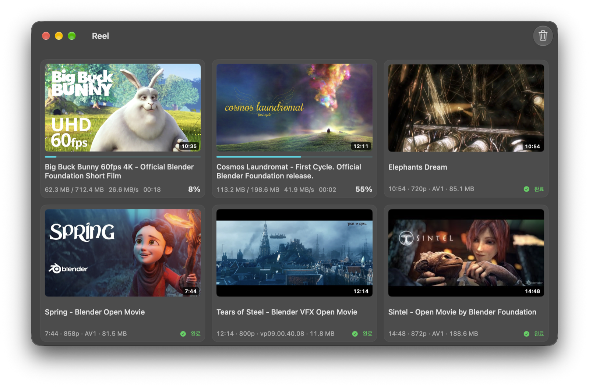
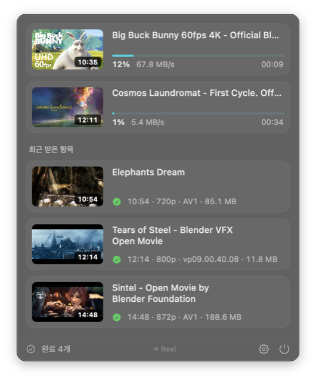
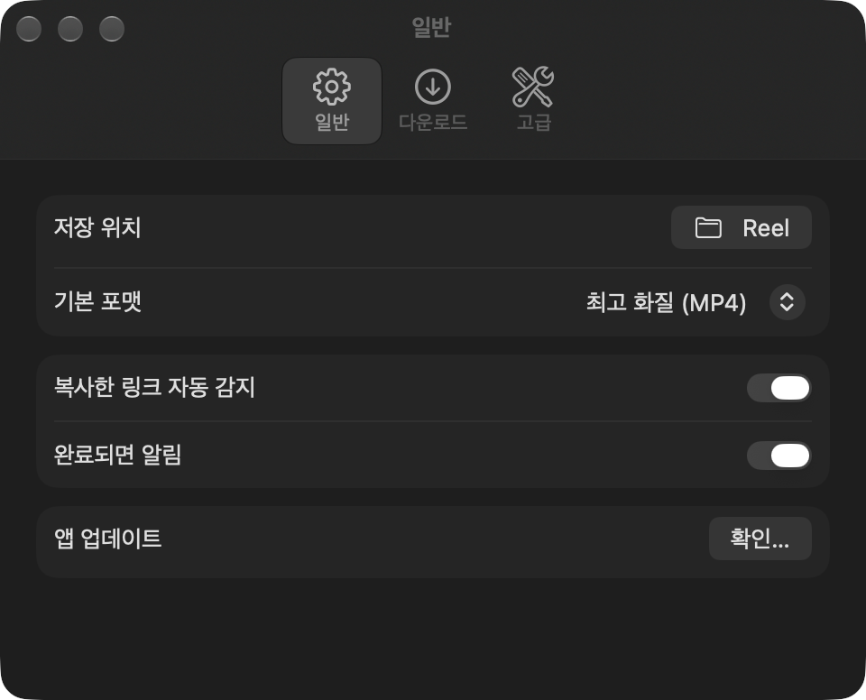
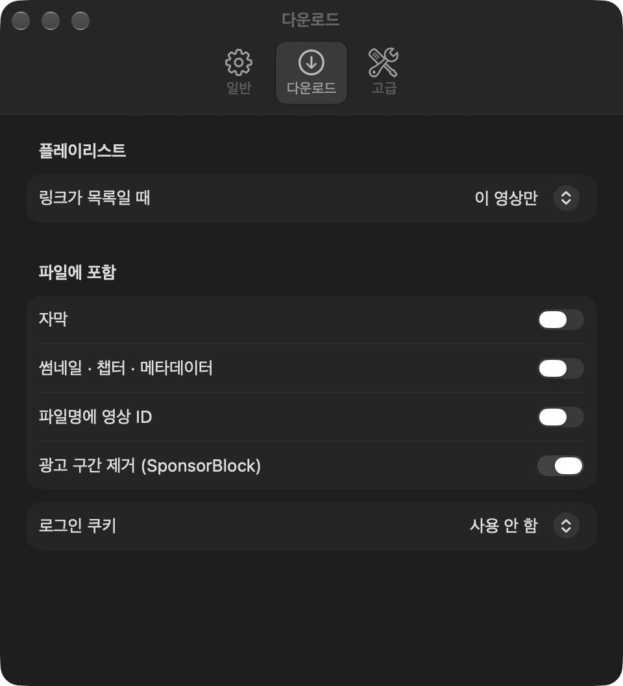
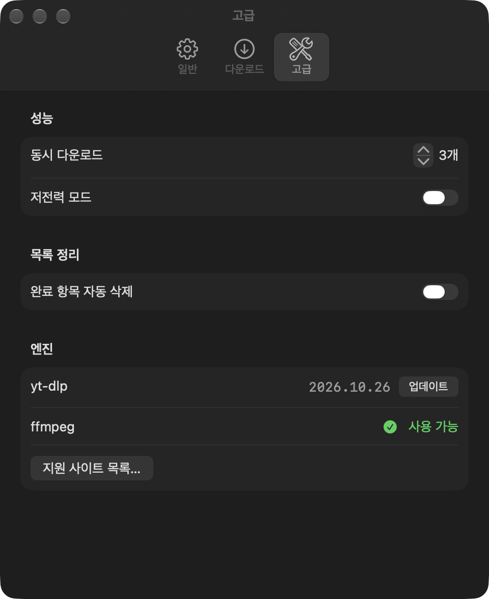

<div align="center">



# Reel

**Copy a link. Click once. It downloads.**

A tiny, native macOS menu bar downloader for YouTube and 1,800+ other sites,<br>
powered by [yt-dlp](https://github.com/yt-dlp/yt-dlp) and [ffmpeg](https://ffmpeg.org).

[](https://github.com/waylake/reel/releases/latest)
[](https://github.com/waylake/reel/actions/workflows/test.yml)


[](LICENSE.md)

[**Download**](https://github.com/waylake/reel/releases/latest) · [Features](#features) · [Install](#install) · [Build from source](#build-from-source) · [Contributing](CONTRIBUTING.md)

<br>



</div>

## Why Reel?

Most downloaders make you paste a URL into a text field, pick a format, then press a button. Reel skips all of that:

1. Copy a video link in your browser (<kbd>⌘</kbd> <kbd>C</kbd>).
2. Click anywhere in Reel, or press <kbd>⌘</kbd> <kbd>V</kbd>.
3. That's it. Reel uses your default format and saves the file to your folder.

No input fields, no format dialogs, no accounts, no tracking.

## Features

|  |  |
| --- | --- |
| 📋 **Clipboard-first** | Reel notices media links you copy. Click the window or menu bar popover to add them, or drag links (or a `.txt` list) onto the window. |
| 🖼️ **Thumbnail cards** | Every download is a card with its thumbnail, live progress, speed and time remaining. Hover over a card for quick actions. |
| 🎚️ **Presets** | Best quality MP4, 1080p (H.264 for compatibility), MP3, M4A, or the original file as-is. |
| 📚 **Playlists & channels** | Download a single video or a whole playlist, with a configurable item limit. |
| ⚡ **Parallel downloads** | Up to 6 downloads at once. Low power mode limits concurrency and bandwidth. |
| 🧩 **Rich files** | Embed subtitles (including auto-generated), chapters, metadata and thumbnails. Strip sponsor segments with SponsorBlock. |
| 🔁 **Resilient** | Retries transient YouTube errors with backoff and can update yt-dlp in place, with no app restart. Download cookies from Safari, Chrome or Firefox for videos that need a login. |
| 💾 **Persistent queue** | Quit at any time. Unfinished items resume on next launch. |
| 🔄 **Auto-updates** | Signed in-app updates via [Sparkle](https://sparkle-project.org). |
| 🔒 **Private** | Everything stays on your Mac. No analytics, no telemetry. See [PRIVACY.md](PRIVACY.md). |

## Screenshots

<table>
  <tr>
    <td width="42%" align="center" valign="top">
      <br>
      <sub><b>Menu bar</b>: active downloads and your latest files, one click away</sub>
    </td>
    <td width="58%" align="center" valign="top">
      <br>
      <sub><b>Settings</b>: just the essentials up front</sub>
    </td>
  </tr>
  <tr>
    <td align="center" valign="top">
      <br>
      <sub>Playlists, subtitles, embeds and SponsorBlock</sub>
    </td>
    <td align="center" valign="top">
      <br>
      <sub>Concurrency, cleanup and the yt-dlp / ffmpeg engine</sub>
    </td>
  </tr>
</table>

<sub>Screenshots show <a href="https://studio.blender.org/films/">Blender open movies</a> (CC BY). The app UI is currently in Korean.</sub>

## Install

**Requirements:** macOS 14 Sonoma or later, on Apple Silicon or Intel.

1. Download `Reel.app.zip` from the [latest release](https://github.com/waylake/reel/releases/latest).
2. Unzip it and move `Reel.app` to `/Applications`.
3. The release build is ad-hoc signed (not notarized). The first time you launch it, **right-click → Open**, or run:

   ```bash
   xattr -dr com.apple.quarantine /Applications/Reel.app
   ```

Release builds include `yt-dlp` and `ffmpeg`, so you don't need anything else. Reel checks for updates automatically.

## Usage

| Action | How |
| --- | --- |
| Add the copied link | Click anywhere in the window or popover, or press <kbd>⌘</kbd> <kbd>V</kbd> |
| Add several links | Drag links or a `.txt` file (one URL per line) onto the window |
| Pause, resume, cancel, open, reveal | Hover over a card, or right-click it |
| Open a finished file | Double-click its card |
| Open the main window | <kbd>⌘</kbd> <kbd>0</kbd>, or click **Completed** in the menu bar popover |
| Settings | <kbd>⌘</kbd> <kbd>,</kbd> |

### Presets

| Preset | What you get |
| --- | --- |
| Best quality (MP4) | Highest available quality, remuxed losslessly to MP4 |
| 1080p (compatible) | Capped at 1080p, H.264 preferred for playback anywhere |
| Audio · MP3 | Audio only, encoded to MP3 |
| Audio · M4A | Audio only, original AAC stream (no re-encode) |
| Original | Whatever the site serves, untouched |

### Troubleshooting

- **Downloads suddenly fail (HTTP 403, "page needs to be reloaded")**: open **Settings → Advanced → yt-dlp → Update**. YouTube changes often, and yt-dlp keeps up.
- **Age-restricted or members-only videos**: set **Settings → Downloads → Login cookies** to the browser you're signed in with.
- **"yt-dlp is required" banner** (source builds only): `brew install yt-dlp ffmpeg`.

## Build from source

```bash
brew install xcodegen yt-dlp ffmpeg
git clone https://github.com/waylake/reel.git
cd reel
xcodegen generate        # creates Reel.xcodeproj from project.yml
open Reel.xcodeproj      # then ⌘R
```

Run the tests:

```bash
xcodebuild test -project Reel.xcodeproj -scheme Reel -destination 'platform=macOS'
```

### Project layout

```
Reel/
├── ReelApp.swift     # App entry: menu bar extra, main window, settings
├── Views/            # SwiftUI views (cards, menu bar popover, settings)
├── Stores/           # @Observable state: queue, settings, clipboard, updater
├── Engine/           # yt-dlp process actor, argument builder, progress parser
├── Models/           # DownloadTask, DownloadOptions, presets, states
└── Support/          # Design tokens, formatting, AppKit bridges
```

The `DownloadEngine` actor runs `yt-dlp` and streams events to the `@MainActor` `QueueStore`. The queue is saved as JSON in `~/Library/Application Support/Reel/`. For details, see [CONTRIBUTING.md](CONTRIBUTING.md).

### Releasing

Push a `v*` tag. GitHub Actions builds the app, bundles `yt-dlp` and `ffmpeg`, signs the update with Sparkle's EdDSA key and publishes the zip and `appcast.xml` to GitHub Releases.

## Contributing

Bug reports, ideas and pull requests are welcome. Please read [CONTRIBUTING.md](CONTRIBUTING.md) and our [Code of Conduct](CODE_OF_CONDUCT.md) first. To report a security issue, follow [SECURITY.md](SECURITY.md).

## Acknowledgements

- [yt-dlp](https://github.com/yt-dlp/yt-dlp) does the downloading.
- [FFmpeg](https://ffmpeg.org) merges and converts the files.
- [Sparkle](https://sparkle-project.org) delivers the updates.
- [SponsorBlock](https://sponsor.ajay.app) provides the segment data.

## Disclaimer

Reel is a front end for yt-dlp. Download only content you have the right to download, and respect each site's terms of service and your local copyright law.

## License

[MIT](LICENSE.md) © 2026 waylake
